<picture>
  <source media="(max-width: 600px)" srcset="assets/profile-terminal-charcoal-mobile.svg">
  
</picture>

# About me.

AI Engineer with 3 years of experience designing and deploying production AI systems. Specialized in multi-agent
LLM architectures that encompass data retrieval, portfolio management, and risk and performance analysis, with end-to-end
ownership from architecture to deployment.

[Explore my work](#selected-work) · [Email](mailto:lucapetrh@gmail.com) · [LinkedIn](https://www.linkedin.com/in/lucapetracca/) · [CV](https://github.com/lucapetrh-dev/lucapetrh-dev/blob/main/docs/Luca-Petracca-CV-2026.pdf)

## Activity at a glance

<picture>
  <source media="(max-width: 600px)" srcset="assets/profile-activity-charcoal-mobile.svg">
  
</picture>

## Selected Work

A selection of personal projects, ongoing research, and customized open-source tools. Private repositories are described without exposing their source code.

### 🛠️ Personal Projects

#### Wallet
A self-hosted finance workspace for managing accounts, transactions, and investments.

- **Finance Management:** Track accounts, transactions, and investment portfolios.
- **Integrations:** Connect financial providers and categorize transactions.
- **Interface:** Mobile-friendly dashboard for everyday financial management.

#### OpenNote
A Windows-based workspace for notes, projects, meeting recordings, and dictation.

- **Organization:** Manage notes and projects in one place.
- **Audio & Transcription:** Record meetings and transcribe spoken content.
- **Privacy:** Notes stay on-device, while transcription and processing use a configured AWS account.

### 💻 Open-Source & Customized Projects

#### [Jobs](https://github.com/lucapetrh-dev/jobsync)
A customized JobSync installation that centralizes the job application process.

- **Application Tracking:** Manage applications, resumes, and contacts.
- **Interview Preparation:** Organize preparation materials and resources.
- **Self-Hosting:** Maintain a private deployment with custom access controls.

#### [Learn](https://github.com/lucapetrh-dev/learn)
A personal learning workflow built around guided questions and visual explanations.

- **Guided Learning:** Explore concepts through structured questions.
- **Visual Explanations:** Support learning with diagrams.
- **Diagram Rendering:** Optionally convert Mermaid and SVG diagrams into PNG images.

### 📊 Research & Data Projects

#### [Financial Forecasting](https://github.com/lucapetrh-dev/Transformers-Financial-Time-Series-Forecasting)
Master's thesis on **Transformers for Financial Time Series Forecasting**, focused on cryptocurrency return prediction.

- **Forecasting:** Develop and benchmark transformer-based models.
- **Evaluation:** Apply leakage-aware evaluation methodologies.
- **Sentiment Analysis:** Compare sentiment-based signals with forecasting approaches.
- **Reproducibility:** Build reproducible experiments and comparable baselines.

#### ECB Data Portal Chatbot
A conversational interface for exploring economic datasets and time series from the European Central Bank.

- **Natural-Language Search:** Find relevant datasets using conversational queries.
- **Data Retrieval:** Combine parallel retrieval with SQL-based value lookups.
- **Visualization:** Dynamically generate charts and tables.
- **Exploration:** Simplify access to economic and financial time series.

---

## Get in Touch

Interested in connecting or discussing a project?

[Connect with me on LinkedIn](https://www.linkedin.com/in/lucapetracca/)

## Contributions

