<picture>
  <source media="(prefers-color-scheme: dark)" srcset="assets/forecast-dark.svg">
  
</picture>

Fig. 1 — Hourly series in 16-hour patches, then a 96-hour forecast with 50, 80 and 95% intervals. Illustrative data.

I'm an ML and AI engineer working with LLMs and generative AI. My master's thesis compared transformers trained on hourly crypto prices with zero-shot time-series foundation models.

### Master's thesis

**[Transformers for Financial Time Series Forecasting in Cryptocurrency Markets](https://github.com/lucapetrh-dev/Transformers-Financial-Time-Series-Forecasting)**

<table>
  <tr><td><b>Data</b></td><td>Hourly prices and sentiment for BTC, ETH, ADA, DOGE, XMR and XRP</td></tr>
  <tr><td><b>Trained</b></td><td>PatchTST- and iTransformer-style models, with and without sentiment features</td></tr>
  <tr><td><b>Zero-shot</b></td><td>Chronos-2, TimesFM and Moirai</td></tr>
  <tr><td><b>Baselines</b></td><td>ARIMA and XGBoost</td></tr>
  <tr><td><b>Ensemble</b></td><td>Ridge regression combined with the best foundation model</td></tr>
  <tr><td><b>Evaluation</b></td><td>Bootstrap 95% confidence intervals, directional binomial tests and the Model Confidence Set</td></tr>
</table>

### Other work

**Forecasting** · [S&P 500 price forecasting](https://github.com/lucapetrh-dev/Stock_Market_Time_Series_Prediction) with data-mining and time-series methods

**Machine learning** · [Recommender Systems Challenge 2022](https://github.com/lucapetrh-dev/Recommender-Systems-Challenge-2022) and [leaf classification with CNNs](https://github.com/lucapetrh-dev/Convolutional-Neural-Network-Leaves-Classification), both Politecnico di Milano competitions · [Logistic regression and K-means on Spark](https://github.com/lucapetrh-dev/Massively-Parallel-Machine-Learning) · [Dementia data analysis](https://github.com/lucapetrh-dev/Dementia-Analysis-Complex_Data_Health)

**Systems and data** · [Redundant controller for a real-time OS](https://github.com/lucapetrh-dev/Controller-Real-Time-Operating-Systems-Project) in C · [Mobile network-traffic analysis](https://github.com/lucapetrh-dev/Network-Traffic-Analysis-Computer-Networks-Project) · [Car-hire system](https://github.com/lucapetrh-dev/Car-Hiring-Software-Engineering-Project) in Java · [TurboEats delivery database](https://github.com/lucapetrh-dev/TurboEats-Database-Project) in PL/SQL · [Open data and knowledge graphs](https://github.com/lucapetrh-dev/Open-Data-and-Knowledge-Graph)

Reach me on [LinkedIn](https://www.linkedin.com/in/lucapetracca/).
